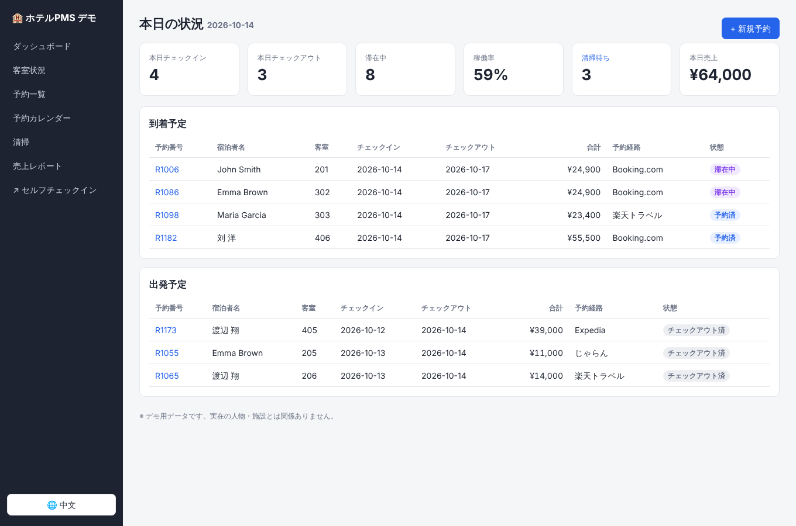
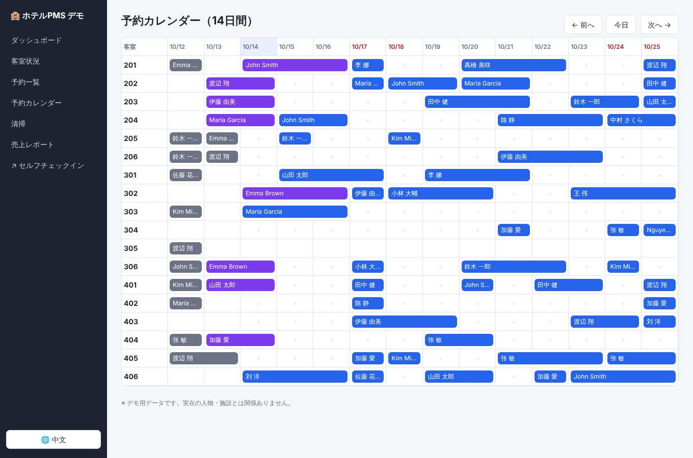
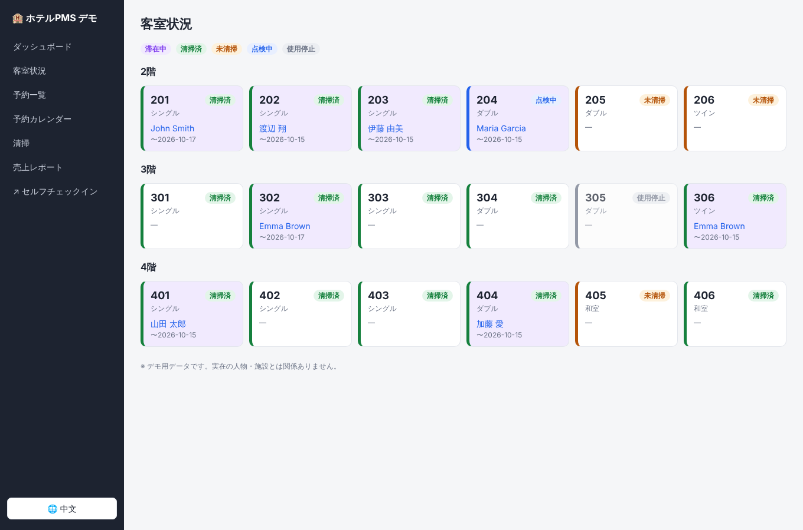
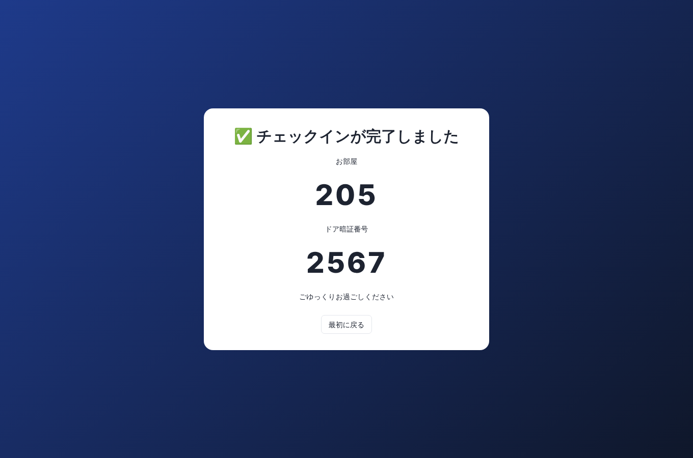
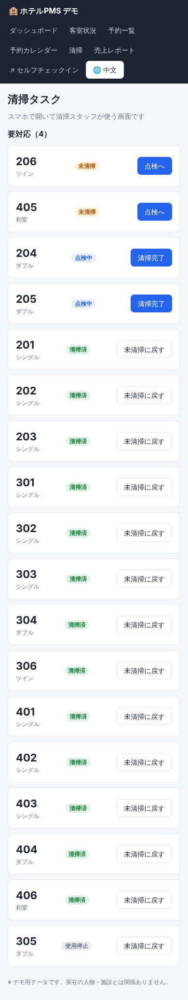

# Hotel PMS（可点击原型 / クリック可能なプロトタイプ）

面向中小型酒店、旅馆、民宿的云端前台管理系统（PMS）原型。功能范围参考了 Staysee 这类日本小型酒店 PMS 的公开介绍，代码是从零编写的。

中小規模のホテル・旅館向けクラウド PMS のプロトタイプです。界面支持**日语 / 中文切换**。



## 功能

| 页面 | 路径 | 内容 |
| --- | --- | --- |
| 仪表盘 | `/` | 今日入住、退房、在住数、入住率、待清扫、今日营收，以及到店和离店列表 |
| 房态 | `/rooms` | 按楼层显示房间卡片：清扫状态、在住客人、离店日期 |
| 预订列表 | `/reservations` | 按姓名、预订号、状态、日期筛选 |
| 新建预订 | `/reservations/new` | 选房间、日期、价格、渠道；**同一房间日期重叠会被拒绝** |
| 预订详情 | `/reservations/[id]` | 办理入住（生成门锁密码）、退房结账、取消、重发密码；房间未清扫时显示警告 |
| 预订日历 | `/calendar` | 14 天甘特图，点击空格直接新建预订 |
| 保洁 | `/housekeeping` | 手机端页面：未清扫 → 检查中 → 已清扫 |
| 营收报表 | `/reports` | 近 30 天的营收、售出间夜、平均房价、入住率，以及按渠道统计 |
| 自助入住 | `/kiosk` | 平板终端：输入预订号或姓名 → 确认 → 付款（演示）→ 显示房号和门锁密码。**房间未清扫时不允许入住** |

| 日历 | 房态 | 自助入住 | 保洁（手机） |
| --- | --- | --- | --- |
|  |  |  |  |

## 运行

需要 Node.js 22.13 或更高版本（使用内置的 `node:sqlite`，不需要编译原生模块）。

```bash
npm install
npm run dev          # http://localhost:3000
```

第一次访问时会自动在 `data/hotel.db` 生成演示数据：18 个房间，前后约 3 周的预订，日期以“今天”为基准。

```bash
npm run reset-data   # 删除数据库，下次访问时重新生成
npm run build && npm start
```

## 技术结构

- **Next.js 16（App Router）+ React 19**：页面是 Server Components，写操作用 Server Actions（`lib/actions.ts`）
- **SQLite**（`node:sqlite`）：表结构和种子数据在 `lib/db.ts`，查询在 `lib/queries.ts`
- **i18n**：`lib/i18n.ts` 存放日语和中文字典，语言保存在 `lang` cookie 里
- 营业日期统一按 `Asia/Tokyo` 时区计算（`lib/dates.ts`）

```
room_types ─< rooms ─< reservations ─< payments
```

## 原型阶段没有做的（下一步）

- 登录和权限（前台、保洁、管理员）
- 对接 OTA 渠道管理器（Booking.com、乐天、Jalan 等）
- 对接智能锁（目前门锁密码只是随机 4 位数）
- 对接真实支付（Stripe、PayPay 等）
- 住宿税、发票（领収書）、住客名册（宿泊者名簿，旅館業法要求）
- 多设施（多店铺）
- 正式环境改用 PostgreSQL
